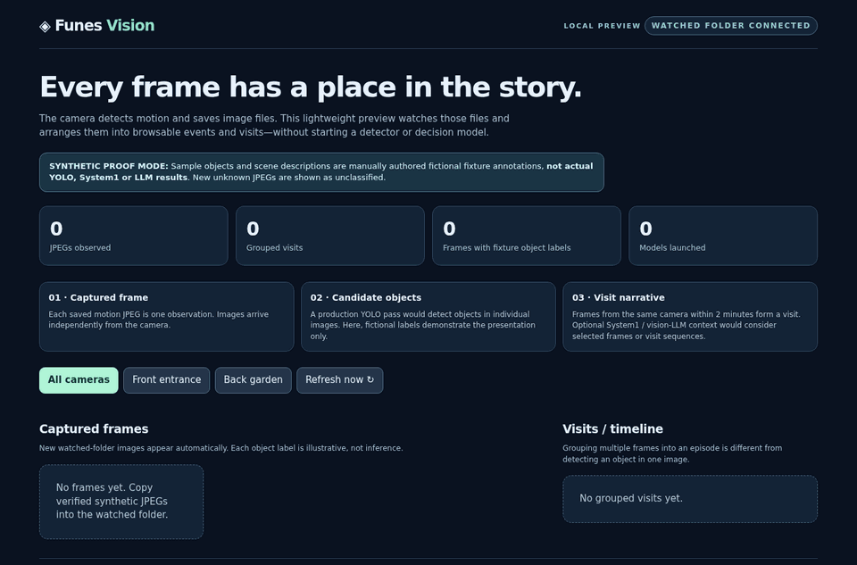
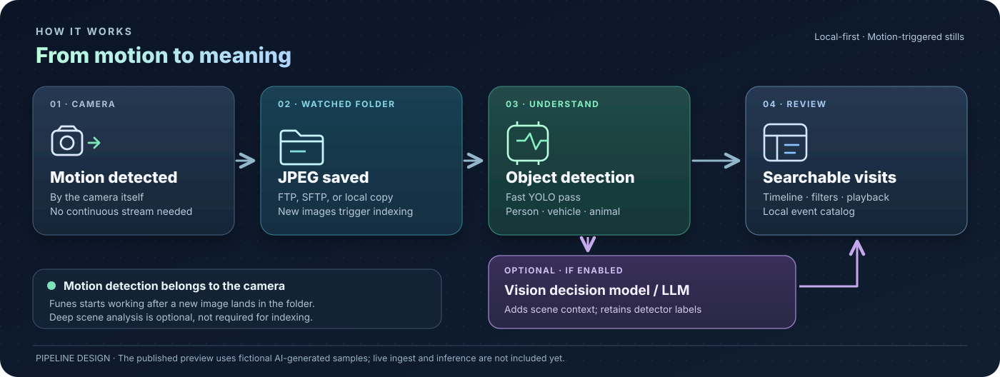
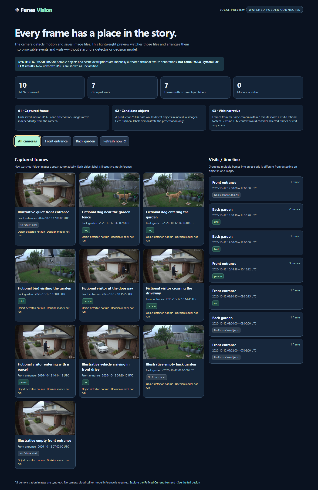
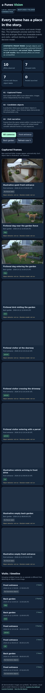

# Funes Vision

**The camera notices motion. Funes helps you find what mattered.**

**Release status: Alpha — local synthetic preview, not a production camera-analysis release.** The public app can scan a watched folder, show JPEGs, and group them into visits. Its separate Refined Current dashboard uses prerecorded fictional fixtures. No live camera connection, YOLO object detection, System1/vision-LLM inference, or production deployment is demonstrated.

Inspired by *Funes the Memorious*, the short story by Jorge Luis Borges about remembering too much. Funes Vision aims to turn motion-triggered stills into a useful, browsable history.



*Real browser capture of the Python folder-watcher: empty → 10 fictional images → grouped visit filtering. Not real surveillance or model inference.*

## Try it locally: one server, two terminals

**Requirements:** Python 3.10+ and a clean checkout. No Python packages, model weights, camera credentials, or cloud accounts are required for this preview. The Python server serves the activity timeline, read-only `/api/activity` and local JPEG files on `127.0.0.1:8000`.

**Terminal 1 — start the Python preview:**

```sh
git clone https://github.com/matthewhand/funes-vision.git
cd funes-vision
python3 -m funes.server
```

Open **http://127.0.0.1:8000/**. With a fresh, empty `runtime/incoming` directory, the timeline starts empty. **Terminal 2 — from the same checkout**, copy hash-verified fictional JPEGs into that directory:

```sh
python3 tools/seed_synthetic_watch.py
```

The browser polls the local API and should show **10 JPEGs** grouped into **7 visits**. A three-frame visitor sequence becomes one grouped episode. The object labels and descriptions are hand-reviewed **fictional fixture annotations**, not detector output. If you reuse a watched folder containing other files, the counts may differ. Stop the Python server with `Ctrl+C`.

### What is actually implemented

| Public preview | Current behavior |
|---|---|
| **Watched-folder activity** (`/`) | Scans two fixed fictional camera folders (`DemoFront`, `DemoBack`), serves new JPEGs and groups nearby timestamps using a 120-second rule. No inference. |
| **Refined Current** (`/frontend/index.html`) | A read-only, more elaborate UI driven by its **own prerecorded fictional dataset**, not by the watched-folder activity API. |
| **Gallery** (`/demo/index.html`) | Displays the bundled synthetic example stills without a live feed. |

**Preview constraints:** the folder scanner selects at most 500 frames with round-robin selection across the two fictional cameras and considers at most 2,000 directory entries per camera per scan. The in-memory digest cache retains only the latest selected frames. Results may be incomplete when a limit is reached; unknown JPEG timestamps come from filesystem modification time; grouping is heuristic rather than a recognized real-world event. On API failure or malformed activity data, the timeline marks existing results **stale** and shows the last successful update rather than presenting them as live; requests time out after 5 seconds. This preview has not undergone production authentication, camera-ingestion or resource-limit validation.

<details>
<summary><strong>Docker Compose</strong> — same Python API, same port</summary>

```sh
mkdir -p runtime/incoming/DemoFront runtime/incoming/DemoBack
docker compose up --build
```

Open **http://127.0.0.1:8000/**; in another terminal run `python3 tools/seed_synthetic_watch.py` to populate the locally mounted synthetic folder. To stop: `Ctrl+C` followed by `docker compose down` if necessary.

`compose.yml` publishes **loopback only** and mounts just `./runtime/incoming` as read-only inside a restricted non-root container. No live cameras are mounted. Docker runs the **Python** server, not Node.js. Images and host settings under `runtime/` are gitignored.

</details>

<details>
<summary><strong>Node.js 20+</strong> — optional static UI development</summary>

```sh
npm start
```

This serves the original static, fictional-data frontend with **no npm dependencies**. It does not scan a watched folder or provide the Python `/api/activity` implementation. Do not run Node and Python simultaneously on port 8000.

</details>

## Camera-ingestion and shared-data contract (next MVP gate)

**Input boundary today:** the Python preview scans finalized `.jpg`/`.jpeg` files already present in two predefined folders, `runtime/incoming/DemoFront` and `runtime/incoming/DemoBack`. It does **not** receive FTP/SFTP uploads, authenticate cameras, watch arbitrary configured cameras, enforce upload atomics, or process video. Use fictional files only; a mounted real camera directory is outside the approved preview scope.

**Required before live ingestion:** an explicit camera allowlist and configurable local inboxes; atomic handoff of finished JPEGs from a separately secured receiver; limits on file size, scan work, retained metadata and memory; documented timestamp provenance and UTC normalization; safe handling of partial uploads, malformed files, symlinks, deletions and duplicate filenames; and an independently reviewed authorization and privacy policy. Do not treat directory access as proof an upstream camera connection is secure.

**Published read-only activity contract (schema version 1, preview-only):** `GET /api/activity` retains existing `frames`, `visits`, `count`, `visit_count`, `mode` and `inference` fields. It now also returns `schema_version: 1`, `data_source: "watched-folder-preview"`, `read_only: true` and `scan` limits (`max_frames`, `max_candidates_per_camera`, `possibly_truncated`). Each frame retains its camera, safe capture URL, `captured_at`, fixture-annotation provenance and `detector_status`/`decision_model_status`, plus `capture_time_source` (`synthetic-fixture` or `filesystem-mtime`). The current scanner reads candidate files only; `count` is the selected number, **not a total archive count**. No image is assigned detector labels from its filename alone. The refined dashboard still uses a separate fixture bridge and **does not consume this API**; adopting the shared contract is a later, independently tested integration.

**Maturity gate:** a consistent schema is necessary but not sufficient for beta. Camera enrollment, safe receiver integration, non-synthetic backend behavior, frontend contract adoption, security and performance evidence remain unimplemented or unverified.

## Target architecture (partly planned)

**Only the JPEG folder scan and basic visit timeline are implemented in the published Python preview.** The following diagram shows the intended product architecture, including future integrations; it is **not** a diagram of a working end-to-end inference pipeline.



**Intended live integration:** a camera performs motion detection and delivers JPEG snapshots to a folder (potentially using FTP/SFTP configured separately). This repository does **not** provide a production FTP/SFTP receiver or a validated live-camera setup. The design separates three levels of understanding:

| Level | What it means | Example |
|---|---|---|
| **Motion frame** | One JPEG written by the motion-detecting camera; Funes sees a newly saved file | `10:14:18`, person carrying a parcel |
| **Object detection** | A fast model such as YOLO would identify candidate objects in **an individual frame**, with its own detector-derived labels | `person` or `car`, before any contextual conclusion |
| **Visit / timeline** | Multiple frames from the same camera in a time window are grouped into a **single episode**, retaining all images and object evidence | Three frames at 10:14:18, 10:14:45 and 10:15:22 form one visitor event |

An optional **System1 decision model or vision LLM** can evaluate selected individual images *or a sequence of frames from a visit*, adding structured interpretations such as *approaching the entrance* or *leaving*. This is deeper scene/temporal interpretation, not the same task as object detection. It must not silently overwrite the original detector labels. Models are optional; the archive can function without one.

**Release boundary:** the published preview performs local indexing and heuristic grouping, not object recognition or vision-based decisions. YOLO/System1/LLM adapters, configurable cameras, safe production ingestion, authentication, resource benchmarks and installation hardening require separate implementation and testing. Track those release gates in [MVP release tracker #2](https://github.com/matthewhand/funes-vision/issues/2).

## Visual proof: watched-folder activity



<details><summary>Mobile capture from the same Python server</summary>



</details>

The activity timeline has a phone-width browser capture above. For the visually richer, **fixture-only** Refined Current interface, open **http://127.0.0.1:8000/frontend/index.html**; for the compact fictional stills gallery, open `/demo/index.html`. All are served by the **same Python process**, but the refined interface's mock API is **not** populated from `/api/activity`.

## Small-hardware design target

The intended reference deployment is **a two-core ARM CPU with 12 GB of RAM**. That's a *design constraint*, not a benchmark or minimum requirement proven for every detector/model combination.

- Motion detection runs on the **camera**, so Funes receives intermittent JPEGs instead of decoding a continuous stream.
- File indexing and timeline rendering should remain lightweight and work **without any model loaded**; the current Python preview uses only standard-library modules and bounded folder scans.
- The object detector is intended to be a comparatively cheap first pass. Expensive decision/vision inference is **optional and selective**, ideally processing a relevant frame or limited visit sequence at a time.
- On small ARM systems, model startup, concurrent inferences, large context windows and full backfills can exhaust CPU or RAM. Inference performance and limits must be measured on the target hardware before we publish resource or throughput claims.

## Verify locally, without hosted CI

Run these commands from the checkout on a development machine; the Python checks use synthetic files and a localhost test server. They do not load inference models or access cameras.

```sh
python3 tests/acceptance_from_readme.py
python3 -m unittest discover -s tests -p test_watched_folder.py
python3 -m unittest discover -s tests -p test_activity_contract.py
python3 tests/check_synthetic_assets.py
python3 tests/check_refined_frontend.py
node --test tests/activity_status.test.cjs  # optional Node.js synthetic status regression
node --test tests/preview-server.test.mjs  # optional Node.js static preview checks
```

Optional Node.js tests exercise the **static** preview, not Python folder ingestion. The Python `test_activity_contract.py` suite checks bounded synthetic input selection, fair camera sampling, provenance, rewrite invalidation, symlink rejection and timestamp grouping without real cameras or inference. The dependency-free Node.js activity-status check uses a simulated DOM and mocked API responses. A separate Playwright script, `tests/activity_browser.cjs`, contains synthetic-only browser checks for connection loss, malformed responses and recovery; running it requires locally available Playwright/Chromium, and it is not implied to pass unless executed. These are local verification instructions: GitHub-hosted CI is not required or requested. Passing synthetic tests does **not** establish production release readiness. Before tagging a stable release, independently verify the live integration, installation, security, licensing, accessibility and small-hardware performance gates tracked in [issue #2](https://github.com/matthewhand/funes-vision/issues/2).

MIT license. Bundled Lucide icons are ISC; see [third-party notices](THIRD_PARTY_NOTICES.md). All supplied image examples are fictional and AI-generated.
