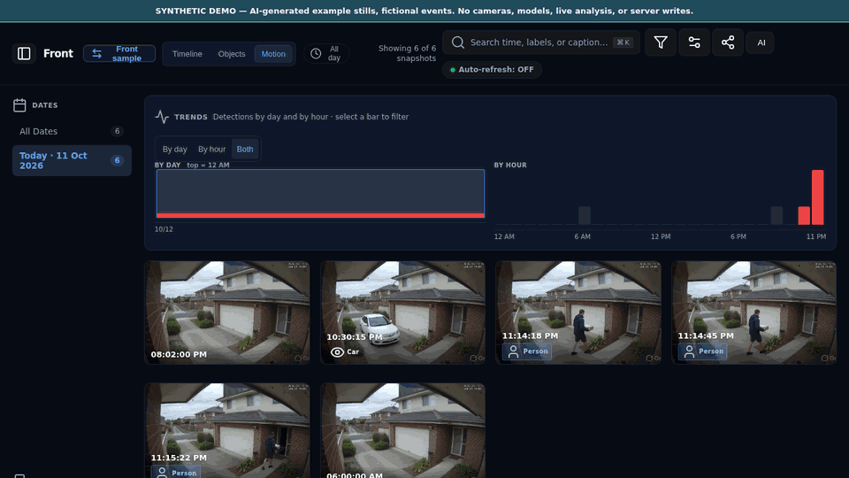
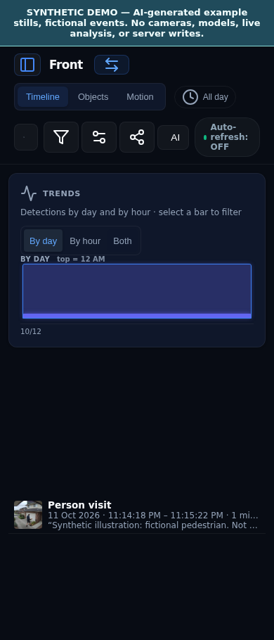

# Funes Vision

**The camera notices motion. Funes helps you find what mattered.**

Inspired by *Funes the Memorious*, the short story by Jorge Luis Borges about the burden of remembering everything. Funes Vision is built around a simpler idea: make a camera's many captured moments easier to explore, filter and understand.



*Real UI, fictional footage. Every image in this preview was AI-generated for demonstration; no real cameras, people or inference results are shown.*

## Try the interactive preview

Browse a camera timeline with two sample camera views, event filters, responsive layouts and image inspection. **This release runs on synthetic data only:** it does not connect to a camera, process motion events or start an AI model.

Run one of these commands from a clone of the repository:

| Option | Start command | Requirements |
|---|---|---|
| **Docker** | `docker compose -f compose.preview.yml up --build` | Docker Engine + Compose |
| **Node.js** | `npm start` or `node server.mjs` | Node 20+, no npm dependencies |
| **Python** | `python3 -m http.server 8000 --bind 127.0.0.1` | Python 3 |

For Docker or Node, open **http://127.0.0.1:8000/**. With Python, open **http://127.0.0.1:8000/frontend/index.html**. The sections below explain each method.

<details open>
<summary><strong>Docker Compose</strong> — build and run the self-contained preview</summary>

Requires Docker Engine and Docker Compose. From the repository directory:

```sh
docker compose -f compose.preview.yml up --build
```

Open **http://127.0.0.1:8000/**. Stop with `Ctrl+C`, then use `docker compose -f compose.preview.yml down` if needed. Docker binds only to your own machine's loopback address, runs as a non-root user, and includes only the synthetic public assets. **No camera folder is mounted.**

</details>

<details>
<summary><strong>Node.js 20+</strong> — run without installing packages</summary>

```sh
npm start
```

Open **http://127.0.0.1:8000/**. The server uses Node's built-in APIs, so there is **no `npm install` step** and no runtime npm dependencies. Stop with `Ctrl+C`.

</details>

<details>
<summary><strong>Python 3</strong> — simplest alternative</summary>

```sh
python3 -m http.server 8000 --bind 127.0.0.1
```

Open **http://127.0.0.1:8000/frontend/index.html**. This is a simple local file server. Stop with `Ctrl+C`.

</details>

The default browser experience is the **[Refined Current timeline](frontend/index.html)**. For a simpler sample gallery, visit **[the synthetic stills viewer](demo/index.html)**. All three hosting options serve the same fictional sample content and do not start the unpublished camera-analysis backend.

## From motion to meaning


**Motion detection happens on the camera, not inside Funes Vision.** The intended live pipeline begins when a motion-detecting camera saves a JPEG to a folder (via FTP, SFTP or another local copy mechanism). Funes then watches that folder, indexes images, and can run a fast YOLO object detector to identify likely people, vehicles or animals.

For selected detections, an **optional vision decision model / LLM** can add structured scene context. It does **not** overwrite object-detector labels. The resulting image records and grouped visits form a searchable timeline. If the decision stage is disabled or unavailable, captured stills can still be indexed and browsed.

The diagram describes the **intended full pipeline**. Only the offline, synthetic frontend demonstration is included in the current public code. A live watched-folder service and inference runtime will be introduced separately.

## What you can explore today

| Timeline and visits | Camera views | Inspect and filter |
|---|---|---|
| Browse example events in time order and review captured stills | Switch between fictional front entrance and back garden cameras | Filter scenes, inspect full-size images, and explore the responsive interface |

<details>
<summary>See the mobile layout</summary>



</details>

## Run the checks

The preview has no installation dependencies beyond your chosen static host. To verify included synthetic assets and the read-only frontend:

```sh
python3 tests/check_synthetic_assets.py
python3 tests/check_refined_frontend.py
node tests/check_refined_frontend_inline.cjs
npm run test:preview
```

The last two checks require Node.js; the image/hash and frontend source checks only need Python 3. `tests/refined_frontend_browser.cjs` contains additional optional Playwright browser regressions.

## Project status and license

**Early preview:** the frontend is interactive and runs locally, but live camera ingestion, YOLO execution, vision-model inference, and production installation are **not included yet**. The demo's subject labels and text are illustrative, not results of a model run.

MIT license. Bundled Lucide icons are ISC-licensed; see [third-party notices](THIRD_PARTY_NOTICES.md). Sample imagery is fictional and AI-generated.
