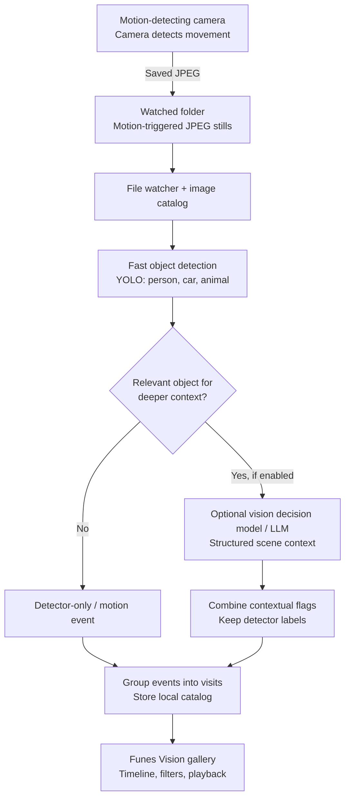

# Funes Vision

> *To remember everything is not the same as understanding what matters.*
>
> An original epigraph inspired by Jorge Luis Borges's short story *Funes the Memorious*.

**A local-first camera timeline that helps make sense of captured moments.**


**All imagery in the animation and demo is AI-generated and fictional.** It does not show real CCTV events or indicate that a detector, inference model or live camera has run.

## How Funes Vision works

**The camera performs motion detection.** Funes Vision does not need a continuous
video feed or run its own motion detection: a motion-detecting IP camera first
saves a JPEG when it notices activity, into a folder Funes Vision watches.
Cameras can upload those stills over FTP/SFTP or another supported local copy
workflow. Funes Vision then processes the saved images.



The object detector identifies candidate subjects; the optional decision/vision
LLM adds structured context for selected candidates, rather than replacing the
detector's labels. If optional analysis is disabled or unavailable, the image
archive can still operate. **The public preview below currently simulates this
flow with fictional data; the live watcher/detector/LLM backend is not included
yet.**

## Try the synthetic frontend preview

This pre-release project currently provides two sample experiences: an accessible standalone [synthetic stills gallery](demo/index.html) and the more complete [Refined Current frontend](frontend/index.html), which demonstrates the timeline, camera switching, archive and inspection UI. Both run entirely against supplied fictional fixtures.

```sh
python3 -m http.server 8000 --bind 127.0.0.1
```

Then open `http://127.0.0.1:8000/frontend/index.html` in a browser, or use `/demo/index.html` for the compact sample gallery. No camera connection, inference runtime, authentication token, or cloud account is required for either demonstration. The preview's API fixture bridge explicitly rejects mutations and does not contact external services.

## Project status

**Early preview.** The interactive frontend currently runs on fictional, AI-generated sample data. Camera ingestion, live analysis, and production installation are not included in this preview. No local cameras or cloud services are contacted by the demonstration.

To verify the fixture byte hashes and safe-file rules using only Python's standard library:

```sh
python3 tests/check_synthetic_assets.py
python3 tests/check_refined_frontend.py
node tests/check_refined_frontend_inline.cjs
```

An optional Playwright browser suite is provided in `tests/refined_frontend_browser.cjs` for a reviewer who already has Chromium/Playwright available.

License: MIT. Icons: Lucide (ISC), with details in [third-party notices](THIRD_PARTY_NOTICES.md).
